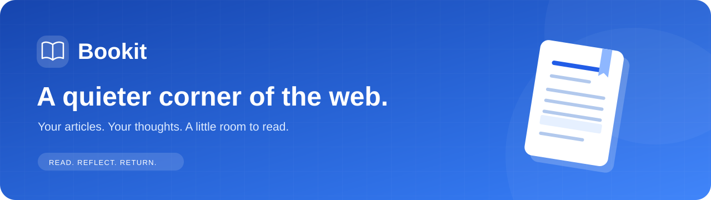
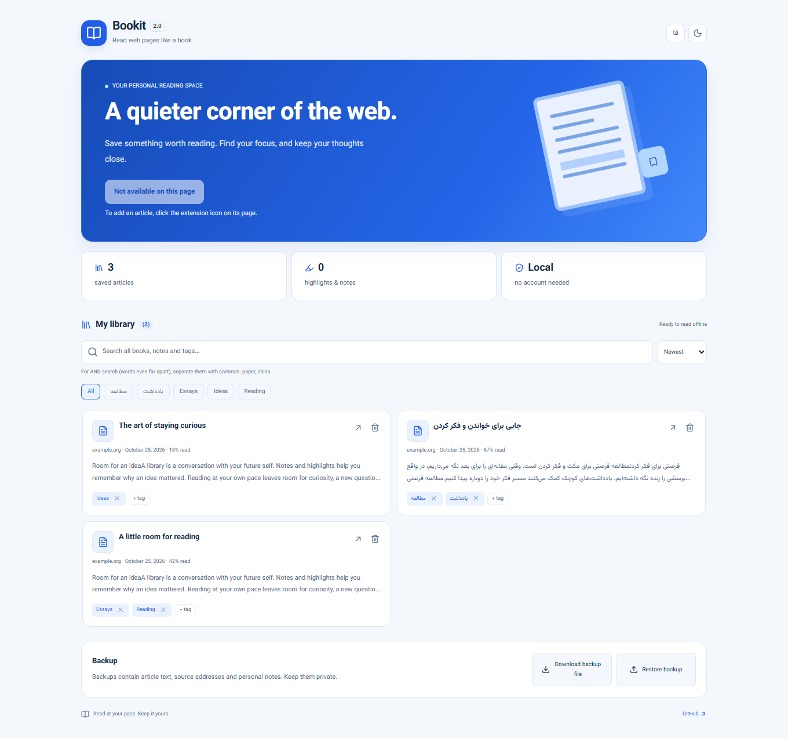
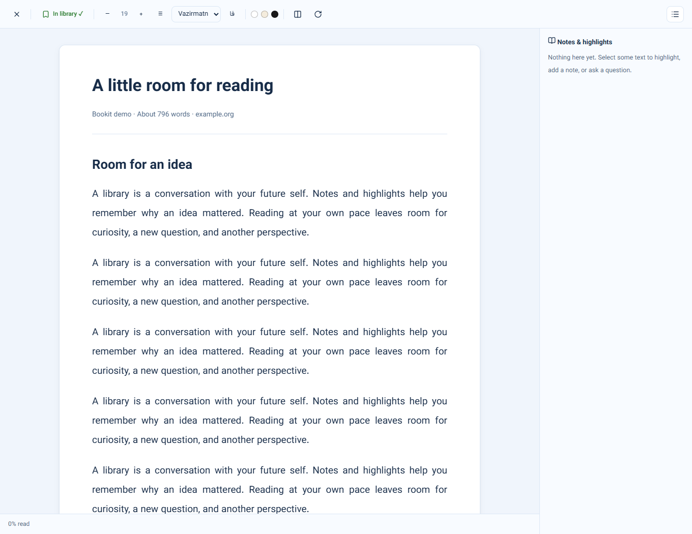
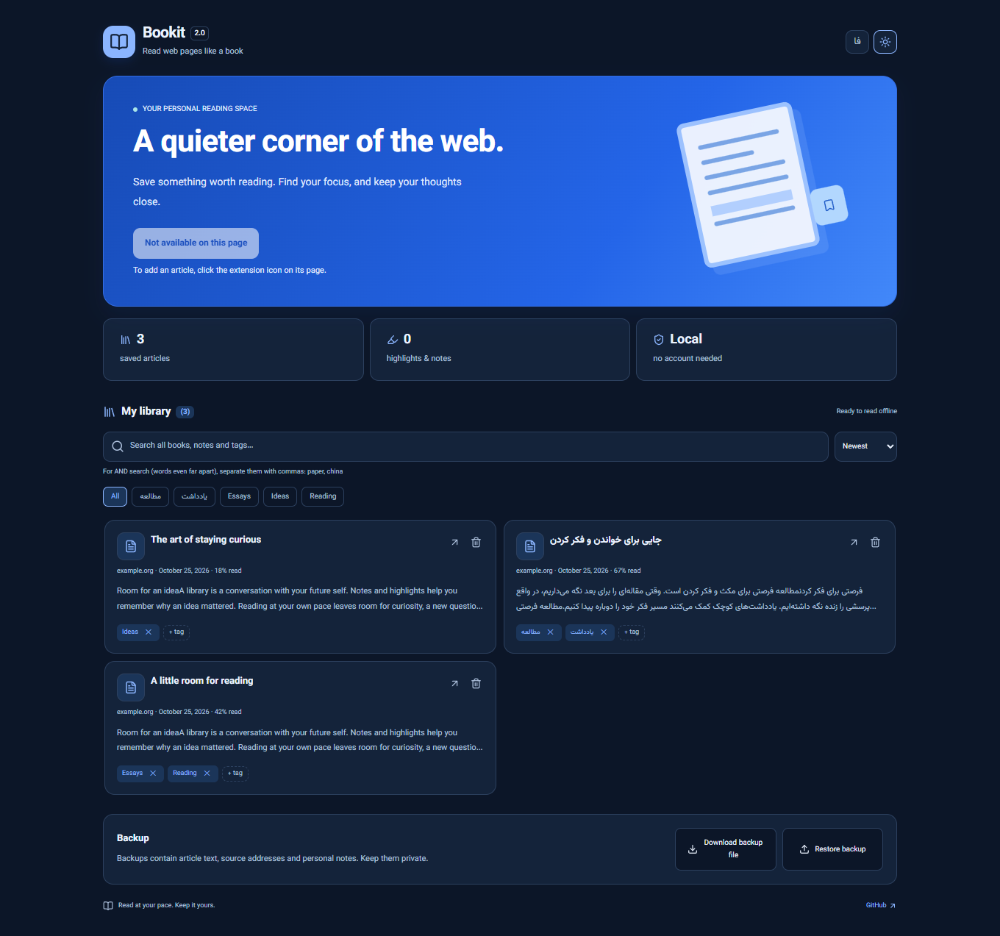

<div align="center">



<br>

[](https://github.com/maboox/bookit/releases/latest)
[](docs/README.fa.md)
[](PRIVACY.md)

[](https://github.com/maboox/bookit/actions/workflows/ci.yml)
[](LICENSE)


**Save something worth reading. Find your focus. Keep your thoughts close.**

A bilingual, local-first reading library for Chrome and Edge.
No account. No cloud service. Your saved text, highlights and notes stay in your browser.

[Install](#install) · [How it works](#how-it-works) · [فارسی](docs/README.fa.md) · [Contribute](CONTRIBUTING.md)

</div>



## A little room for reading

Bookit turns an article into a quiet reading space, then lets you build a personal
library around the ideas you want to revisit.

| Read with focus                  | Make it yours                  | Come back later                     |
| -------------------------------- | ------------------------------ | ----------------------------------- |
| Mozilla Readability extraction   | Four highlight colors          | Saved copies open offline           |
| Light, paper and dark themes     | Notes, questions and answers   | Search article text and annotations |
| Adjustable type and line spacing | Persian and English interfaces | Tags, sorting and progress          |
| Scroll or page-by-page reading   | Bundled OFL Vazirmatn font     | Validated JSON backup and restore   |

The blue-and-white library includes previews, reading progress, a separate original
source link and a full-page view. Runtime libraries, icons and fonts are bundled
locally. Remote images and embeds are excluded from saved copies.

<details>
<summary>See the reader and dark library</summary>





</details>

## Install

1. Download **bookit-2.0.0.zip** from [Releases](https://github.com/maboox/bookit/releases/latest) and extract it.
2. Open `chrome://extensions` in Chrome or `edge://extensions` in Edge.
3. Enable **Developer mode**, choose **Load unpacked**, and select the extracted
   `bookit` folder containing `manifest.json`.
4. Pin Bookit to your browser toolbar. Open an article and click the Bookit icon.

Requires Chromium 120 or later. The repository itself can also be loaded unpacked;
no build is needed. This is a downloadable developer-mode extension, not a Chrome
Web Store listing. A store publication is a separate process.

## How it works

1. **Read:** click **Read this page as a book** on a normal article page.
2. **Keep:** choose **Save to library**, optionally add tags. Reading alone does not
   save a new article; adding a highlight or note saves it automatically.
3. **Think:** select text to highlight it, write a note or leave a question and
   answer. Open the notes panel to revisit a passage.
4. **Return:** open the full library and select an article title to read its saved
   copy, even offline. The arrow next to it opens the original website.
5. **Find:** search across text, notes and tags. Comma-separated terms use AND:
   `reading, curiosity`. Persian letter variants and diacritics are normalized.
6. **Back up:** export a private JSON file. Restore validates it before merging;
   matching source addresses and included settings are replaced. Export first
   before a restore if you want to preserve an older copy.

**Keyboard:** `Alt+Shift+B` opens the library. In page mode use the arrows,
`PageUp`/`PageDown` or Space. Escape closes a dialog or the reader. Shortcuts can
be changed in the browser's extension shortcut settings.

## Privacy, permissions and limits

Bookit asks for `storage`, `activeTab` and `scripting`. It has no persistent host
permissions and activates only after your request. Saved reading makes no external
network requests. Dictionary links visit an external service only when clicked.

Local storage and JSON backups are **not encrypted**. On-page reading is not a
security boundary against a malicious source website; use the extension-owned
saved reader for private notes. Avoid editing a book in multiple readers at once.
The storage budget is normally 10 MB; backup files are limited to 8 MiB.
Browser internal pages, web stores, PDF viewers and unusual page structures may
not be readable. See the [privacy policy](PRIVACY.md),
[security review](docs/SECURITY_REVIEW.md) and [architecture](docs/ARCHITECTURE.md).

## Development

```sh
npm ci --ignore-scripts
npx playwright install chromium
npm run check
```

Node.js 22+. `npm run vendor` regenerates offline dependencies after an upgrade.
`npm run package` creates a reproducible runtime ZIP and `SHA256SUMS.txt` in
`artifacts/`. CI checks the source, dependencies, secrets, installed extension,
accessibility and release package. See [contributing](CONTRIBUTING.md).

## فارسی

**Bookit — جایی برای خواندن و فکر کردن.** مقاله‌های وب را با ظاهر آبی‌وسفید،
فونت خوانا و حالت روشن، کاغذی یا تاریک بخوانید؛ هایلایت و یادداشت بسازید و
نسخهٔ متنی را برای مطالعهٔ آفلاین نگه دارید. همهٔ داده‌ها در مرورگر خودتان
می‌مانند. [راهنمای کامل فارسی ←](docs/README.fa.md)

## License and credits

[MIT](LICENSE) for Bookit code. Built with [Mozilla Readability](https://github.com/mozilla/readability),
[DOMPurify](https://github.com/cure53/DOMPurify), [Lucide](https://lucide.dev) and
[Vazirmatn](https://github.com/rastikerdar/vazirmatn).
[Third-party licenses](THIRD_PARTY_NOTICES.md) are included in the download.
