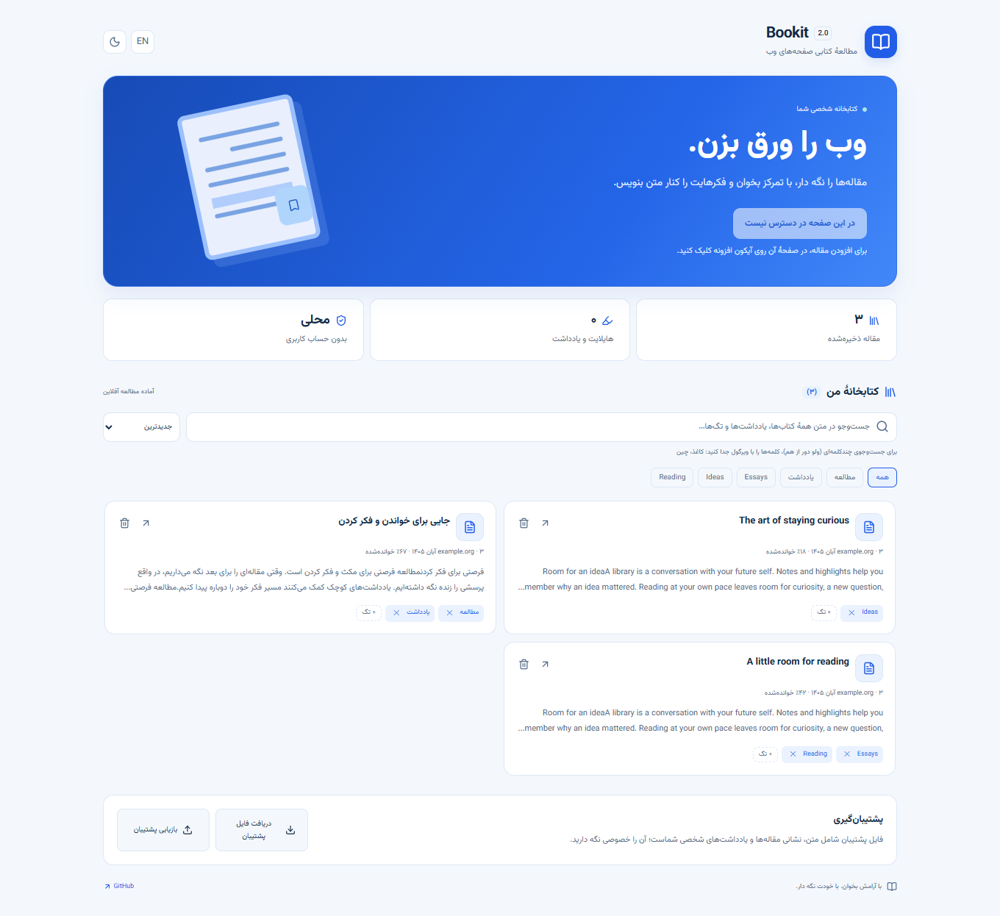

# Bookit — جایی برای خواندن و فکر کردن

افزونهٔ فارسی و انگلیسی برای تبدیل مقاله‌های وب به فضایی آرام برای مطالعه،
هایلایت و یادداشت‌برداری؛ با کتابخانهٔ محلی و مطالعهٔ آفلاین.

[دریافت آخرین نسخه](https://github.com/maboox/bookit/releases/latest) ·
[English](../README.md) · [حریم خصوصی](../PRIVACY.md)

## امکانات

- ظاهر آبی‌وسفید، تم تاریک کتابخانه و سه زمینهٔ مطالعه: روشن، کاغذی و تاریک.
- استخراج متن مقاله با Mozilla Readability و پاک‌سازی محتوای ناامن با DOMPurify.
- فونت آزاد وزیرمتن همراه افزونه، تنظیم اندازه و فاصلهٔ خطوط و ورق‌زدن.
- هایلایت چهاررنگ، یادداشت، پرسش و پاسخ متصل به متن.
- ذخیرهٔ متن برای مطالعهٔ آفلاین، نگه‌داشتن جای مطالعه و لینک جداگانهٔ منبع.
- جست‌وجو در متن، یادداشت و تگ؛ مرتب‌سازی و فیلتر تگ.
- جست‌وجوی چندواژه‌ای با ویرگول: `مطالعه، کنجکاوی`؛ همهٔ واژه‌ها باید وجود داشته باشند.
- پشتیبان JSON و بازیابی اعتبارسنجی‌شده با پشتیبانی از فایل‌های قدیمی.
- رابط فارسی راست‌به‌چپ و انگلیسی چپ‌به‌راست، آیکون‌های Lucide و کنترل با صفحه‌کلید.

## نصب

۱. فایل `bookit-2.0.1.zip` را از صفحهٔ [انتشارها](https://github.com/maboox/bookit/releases/latest)
بگیرید و استخراج کنید.

۲. در Chrome نشانی `chrome://extensions` یا در Edge نشانی `edge://extensions` را باز کنید.

۳. گزینهٔ **Developer mode** را روشن کنید، **Load unpacked** را بزنید و پوشهٔ
`bookit` حاوی فایل `manifest.json` را انتخاب کنید.

۴. آیکون افزونه را سنجاق کنید؛ به یک صفحهٔ مقاله بروید و روی Bookit کلیک کنید.

حداقل Chromium 120 لازم است. نصب از خود پوشهٔ ریپو هم ممکن است و به ساخت پروژه
نیازی ندارد. این نسخه برای نصب دستی است؛ هنوز در فروشگاه Chrome منتشر نشده است.

## روش کار

۱. **مطالعه:** روی «نمایش این صفحه به‌صورت کتاب» کلیک کنید.

۲. **نگه‌داشتن:** از نوار مطالعه «ذخیره در کتابخانه» را بزنید؛ تگ اختیاری است.
خواندن ساده مقاله را ذخیره نمی‌کند؛ ساخت هایلایت یا یادداشت آن را خودکار ذخیره می‌کند.

۳. **یادداشت:** بخشی از متن را انتخاب و هایلایت، یادداشت یا پرسش بسازید.
پنل یادداشت‌ها شما را به بخش مربوط متن برمی‌گرداند.

۴. **ادامه:** در کتابخانه روی عنوان مقاله بزنید تا نسخهٔ ذخیره‌شده داخل افزونه
باز شود؛ اینترنت و فعال‌بودن سایت اصلی لازم نیست. علامت پیکان، منبع اصلی را باز می‌کند.

۵. **پشتیبان:** فایل JSON را خصوصی نگه دارید. بازیابی، کتاب‌های هم‌نشانی و تنظیمات
موجود در فایل را جایگزین می‌کند؛ کتاب‌های دیگر باقی می‌مانند. قبل از بازیابی از
اطلاعات فعلی پشتیبان بگیرید.

میان‌بر `Ctrl+Shift+Y` کتابخانه را باز می‌کند. در حالت ورق‌زدن، کلیدهای جهت،
`PageUp`، `PageDown` و فاصله کار می‌کنند. `Escape` پنجره یا نمای مطالعه را می‌بندد.
میان‌برها در تنظیمات افزونه‌های مرورگر قابل تغییرند.

## حریم خصوصی و محدودیت‌ها

Bookit حساب، فضای ابری، آمارگیری یا سرور اختصاصی ندارد. فقط پس از درخواست شما
به صفحه دسترسی می‌گیرد و دسترسی دائمی به همهٔ سایت‌ها ندارد. متن ذخیره‌شده
تصویر و محتوای خارجی را بارگیری نمی‌کند. واژه‌نامه تنها با کلیک روی لینک سایت
آن، واژهٔ انتخابی را دریافت می‌کند.

داده‌های محلی و فایل پشتیبان رمزگذاری نمی‌شوند. برای یادداشت خصوصی از نسخهٔ
ذخیره‌شده در تب خود افزونه استفاده کنید. یک کتاب را هم‌زمان در چند پنجره ویرایش
نکنید؛ ذخیرهٔ آخر می‌تواند تغییر قبلی را جایگزین کند. حافظهٔ معمول مرورگر حدود
۱۰ مگابایت و سقف فایل پشتیبان ۸ مگابایت است. صفحه‌های داخلی مرورگر، فروشگاه‌ها،
نمایشگر PDF و ساختارهای غیرمعمول ممکن است قابل استخراج نباشند.

[سیاست کامل حریم خصوصی](../PRIVACY.md) · [گزارش بررسی امنیت](SECURITY_REVIEW.md)

## توسعه و مجوز

برای توسعه، Node.js 22 یا بالاتر نصب کنید، `npm ci --ignore-scripts` و سپس
`npx playwright install chromium` و `npm run check` را اجرا کنید.
فایل نصب با `npm run package` ساخته می‌شود. [راهنمای مشارکت](../CONTRIBUTING.md)

کد Bookit با مجوز [MIT](../LICENSE) منتشر می‌شود. مجوز کتابخانه‌ها، آیکون‌ها و
فونت همراه در [فهرست مجوزها](../THIRD_PARTY_NOTICES.md) آمده است.

